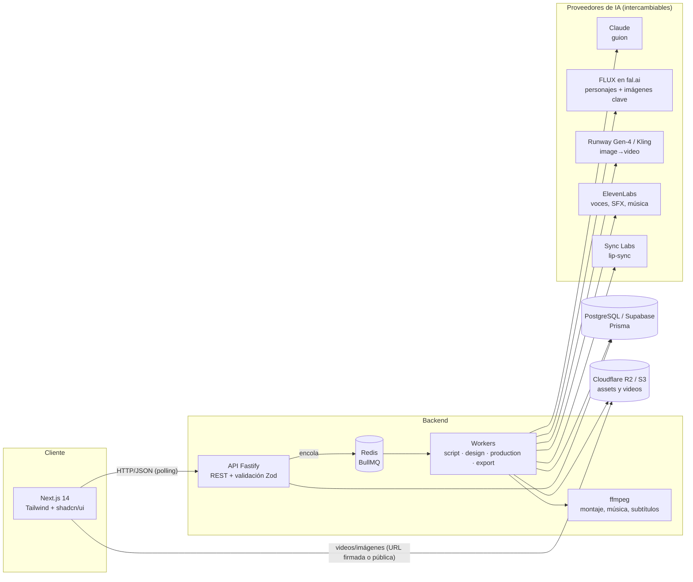
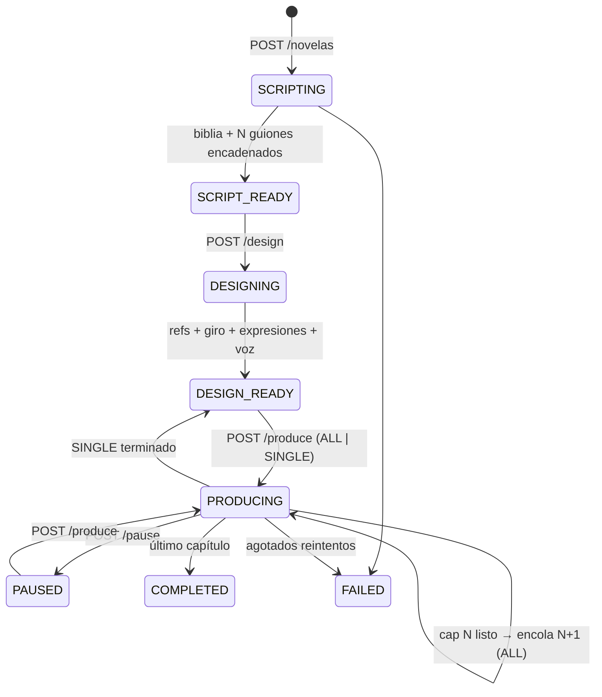
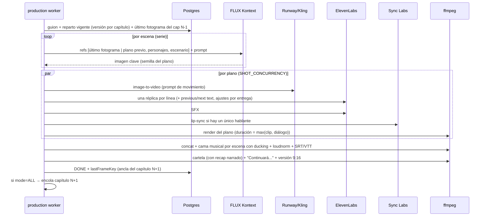
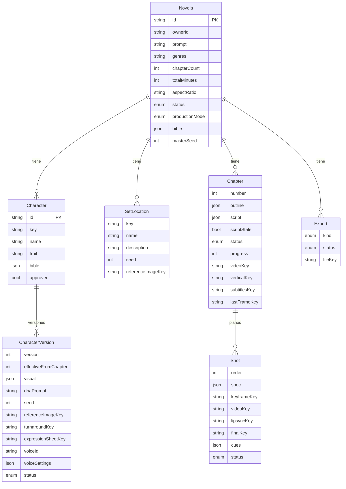

# 1. Arquitectura de FrutiNovela AI

## 1.1 Visión general



| Capa | Tecnología | Por qué |
|---|---|---|
| Frontend | Next.js 14 (App Router), Tailwind, componentes shadcn/ui (Radix) | SSR/estático en Vercel, componentes accesibles, estética telenovela con tokens CSS |
| API | Node 20+, Fastify 4, Zod | Un solo lenguaje (TypeScript) en todo el monorepo; esquemas compartidos API↔web↔Claude |
| Colas | BullMQ sobre Redis | Reintentos con backoff, jobs deterministas (sin duplicados), concurrencia por cola, workers escalables |
| BD | PostgreSQL (Supabase compatible) + Prisma | JSONB para guiones editables, relaciones fuertes para versiones de personajes |
| Storage | Cloudflare R2 (S3 API) — o S3 / MinIO; disco local en dev | Sin coste de egress en R2: clave para servir videos |
| Post-producción | ffmpeg | Determinista, gratis, sin GPU: montaje, ducking musical, loudness −14 LUFS, subtítulos, versiones 9:16 |
| Guion | Claude (`claude-opus-5-5`) con salidas estructuradas | JSON validado contra Zod, fallbacks del servidor, prompt caching |
| Imagen | FLUX 1.1 Pro Ultra + FLUX Kontext Max Multi (fal.ai) | Semilla fija para referencias + edición multi-imagen para meter personajes en cada plano |
| Video | Runway Gen-4 Turbo o Kling 2.x (image-to-video) | Partir de imagen clave = máxima consistencia de personaje |
| Voz | ElevenLabs (multilingual v2 / v3) | Voces latinas, control emocional, `previous_text`/`next_text`, semilla |
| Lip-sync | Sync Labs `lipsync-2` (o Wav2Lip/LatentSync self-hosted) | Labios sincronizados en planos con un solo hablante |
| Música | Biblioteca con licencia / Eleven Music | Leitmotivs: una pista por emoción y por novela, reutilizada en todos los capítulos |

> **Suno / Udio** no tienen API pública oficial. El `MusicProvider` es una interfaz de una función: si consigues acceso comercial, añade un adaptador sin tocar el pipeline.

Todos los proveedores tienen un modo **`mock`** (placeholders generados con ffmpeg). Con todo en mock el sistema entero —guion, diseño, 8–12 capítulos, montaje, exportaciones— funciona en local sin una sola clave de API.

## 1.2 Flujo de usuario ↔ estados



1. **Inicio** “Crea tu FrutiNovela” → prompt + géneros + nº de capítulos (8–12) + duración (12–30 min) + formato + acento.
2. **Guion**: Claude genera la *biblia* (personajes, escenarios, escaleta con cliffhangers) y después cada capítulo plano a plano, **en orden**, porque el capítulo N recibe el `endState` exacto del N-1. El usuario puede editar cualquier plano/diálogo o reescribir un capítulo (y, opcionalmente, los siguientes en cascada).
3. **Personajes**: por cada uno, hoja de referencia (semilla fija), hoja de giro, hoja de expresiones, voz asignada y preview de voz. Aprobar / regenerar (otra semilla) / editar (vestuario, accesorios, voz, emoción) **desde el capítulo X**.
4. **Producción**: “Generar todos los videos en secuencia” o “Solo el siguiente”. Barra de progreso global + progreso por capítulo + miniaturas de las imágenes clave según aparecen.
5. **Playlist**: reproducción continua en orden, versión master o vertical, descarga individual, subtítulos, ZIP, serie vertical o un único video largo, compartir.
6. **Historial**: `/novelas`.

## 1.3 Pipeline de un capítulo



Decisiones clave:

- **Un job = un capítulo**, y el siguiente solo se encola al terminar el anterior. Garantiza el orden (el N+1 necesita el último fotograma del N) y evita saturar la API de video. Dentro del capítulo, `SHOT_CONCURRENCY` limita las llamadas simultáneas.
- **Reanudable**: cada plano guarda su imagen clave, video y render final en storage. Si el job se cae o se reintenta, los planos terminados cuyo `spec` no cambió se reutilizan. Si editas un plano, solo se rehace ese plano y los siguientes de la misma escena (las imágenes clave están encadenadas).
- **Degradación elegante**: si el proveedor de video rechaza un plano (p.ej. moderación), ese plano se anima con Ken Burns sobre su imagen clave y se registra el aviso; el capítulo no se cae. Los errores transitorios (429/5xx/timeout) sí reintentan el job.
- **Errores no recuperables** (`ProviderError.retryable=false`, rechazo de Claude) se convierten en `UnrecoverableError` para no gastar reintentos.

## 1.4 Estructura de carpetas

```
frutinovela-ai/
├── package.json                 # npm workspaces
├── docker-compose.yml           # postgres + redis + minio + api + worker + web
├── packages/
│   └── shared/                  # @fruti/shared — TS fuente compartido
│       └── src/
│           ├── schemas.ts       # Zod: StoryBible, ChapterScript, requests (también = structured outputs de Claude)
│           ├── constants.ts     # catálogo de frutas, STYLE LOCK, resoluciones, estados
│           └── dto.ts           # tipos JSON de la API
├── apps/
│   ├── api/
│   │   ├── prisma/schema.prisma # + migrations/
│   │   ├── Dockerfile           # imagen única para API y worker (incluye ffmpeg)
│   │   └── src/
│   │       ├── server.ts        # Fastify
│   │       ├── worker.ts        # workers BullMQ
│   │       ├── config.ts        # env validado con Zod
│   │       ├── routes/index.ts  # endpoints REST
│   │       ├── queues/index.ts  # colas y jobIds deterministas
│   │       ├── lib/             # db, storage (R2/S3/local), ffmpeg, http/poll, seeds
│   │       ├── prompts/         # PROMPTS MAESTROS: script, character, video, voice
│   │       ├── providers/       # llm (claude|mock), image (fal|mock), video (runway|kling|mock),
│   │       │                    # tts (elevenlabs|mock), lipsync (synclabs|none), music (library|elevenlabs|mock)
│   │       └── services/
│   │           ├── orchestrator.ts  # máquina de estados
│   │           ├── script.ts        # biblia + capítulos + normalización
│   │           ├── characters.ts    # diseño, versiones, voces
│   │           ├── continuity.ts    # SISTEMA DE CONTINUIDAD
│   │           ├── production.ts    # pipeline de capítulo
│   │           ├── export.ts        # ZIP / video largo / serie vertical
│   │           └── serialize.ts     # Prisma → DTO con URLs
│   └── web/
│       ├── app/
│       │   ├── page.tsx             # “Crea tu FrutiNovela”
│       │   ├── novelas/page.tsx     # historial
│       │   └── novelas/[id]/page.tsx# workspace (guion · personajes · producción · playlist)
│       ├── components/ui/           # shadcn/ui
│       ├── components/novela/       # create-form, script-tab, script-editor, characters-tab,
│       │                            # production-tab, playlist-tab, workspace, status-badge
│       ├── hooks/use-novela.ts      # polling adaptativo
│       └── lib/api.ts               # cliente REST
└── docs/
```

## 1.5 Esquema de base de datos

Definido en [`apps/api/prisma/schema.prisma`](../apps/api/prisma/schema.prisma); la migración SQL inicial está en `apps/api/prisma/migrations/`.



Puntos de diseño:

- **Claves de storage, no URLs**, en la BD: las URLs firmadas caducan. `serialize.ts` genera URLs al responder.
- **`bible` y `script` en JSONB**: son los documentos que el usuario edita y que Claude lee; se validan con los mismos esquemas Zod en cada escritura.
- **`CharacterVersion.effectiveFromChapter`**: cambio de diseño o de voz a mitad de historia sin alterar capítulos ya producidos. La versión de un capítulo es la de mayor `version` con `effectiveFromChapter ≤ N`.
- **`masterSeed`**: todas las semillas (personajes, escenarios, planos) se derivan de ella con SHA-256 → reproducibilidad total.
- **`Shot.spec`** guarda el plano + datos de escena desnormalizados: comparar `spec` es lo que hace el render reanudable.

## 1.6 API REST

Todas las rutas cuelgan de **`/api`** (mismo contrato en local, Docker y Vercel, donde la rewrite `/api/(.*)` envía el tráfico al servicio `api`).

| Método | Ruta | Descripción |
|---|---|---|
| GET | `/api/novelas` | Historial del propietario (`x-owner-id`) |
| POST | `/api/novelas` | Crea y lanza el guion (`CreateNovelaSchema`) |
| GET | `/api/novelas/:id` | Novela completa (biblia, personajes, capítulos, exports) |
| PATCH | `/api/novelas/:id` | Título, tagline, subtítulos |
| DELETE | `/api/novelas/:id` | Borra todo |
| POST | `/api/novelas/:id/script` | Reescribe biblia + todos los capítulos |
| GET | `/api/novelas/:id/chapters/:n` | Capítulo con planos (miniaturas en vivo) |
| PUT | `/api/novelas/:id/chapters/:n/script` | Guarda el guion editado (validado y normalizado) |
| POST | `/api/novelas/:id/chapters/:n/regenerate-script` | `{cascade}` reescribe este (y los siguientes) |
| POST | `/api/novelas/:id/design` | Diseña personajes y escenarios `{characterIds?}` |
| POST | `/api/characters/:id/approve` | Aprueba el diseño vigente |
| POST | `/api/characters/:id/regenerate` | Nueva versión con otra semilla |
| PATCH | `/api/characters/:id` | Cambia visual/voz `{effectiveFromChapter}` → nueva versión |
| GET | `/api/voices` | Catálogo de voces del proveedor TTS |
| POST | `/api/novelas/:id/produce` | `{mode: "ALL" \| "SINGLE", number?}` |
| POST | `/api/novelas/:id/pause` | Pausa al acabar el plano en curso |
| POST | `/api/novelas/:id/exports` | `{kind: "ZIP" \| "LONG_VIDEO" \| "VERTICAL_SERIES"}` |
| GET | `/api/files/*` | Solo `STORAGE_DRIVER=local`, con soporte Range |

## 1.7 Escalado y costes

- **Workers horizontales**: cualquier número de réplicas de `worker.js` comparten Redis. `CHAPTER_CONCURRENCY` (capítulos de novelas distintas por réplica) × `SHOT_CONCURRENCY` (planos simultáneos por capítulo) = llamadas concurrentes máximas al proveedor de video. Ajusta a tu límite de cuenta.
- **Disco**: cada capítulo usa un directorio temporal (`WORK_DIR`) que se borra al terminar; reserva ~2 GB por capítulo concurrente.
- **Coste por novela**: domina el video. Fórmula: `nº de planos × coste por clip de 5/10 s` + `caracteres de diálogo × tarifa TTS` + `imágenes × tarifa FLUX` + tokens de Claude (pequeño: ~10 llamadas, system prompt cacheado). Una novela de 20 min tiene ~150–200 planos. Consulta las tarifas actuales de cada proveedor antes de fijar precios a tus usuarios; empieza siempre probando con `VIDEO_PROVIDER=mock` y un solo capítulo real.
