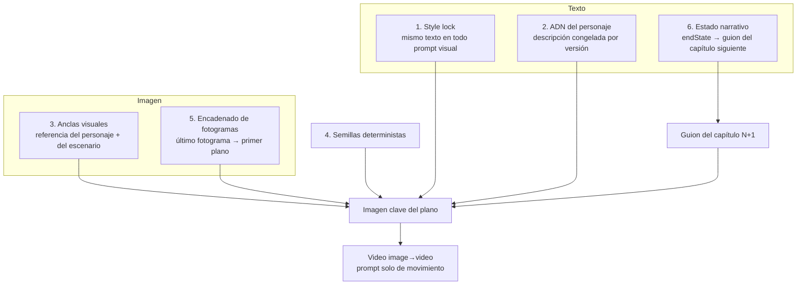

# 3. Sistema de continuidad

Objetivo: que 150–200 clips generados por separado, por modelos distintos y a lo largo de horas, se vean como **una sola telenovela**: mismos personajes, mismos vestuarios, misma estética, y cada capítulo empezando exactamente donde terminó el anterior.

Ningún modelo de video actual garantiza eso por sí solo. La continuidad sale de **apilar seis capas**, cada una cubriendo los fallos de las otras. Implementación: `apps/api/src/services/continuity.ts`, `prompts/*`, `services/production.ts`.

## Capa 1 — Style lock

`VISUAL_STYLE_LOCK` (`packages/shared/src/constants.ts`) se añade **idéntico** al final de cada prompt de referencia, escenario e imagen clave. Define motor de render (Pixar/DreamWorks), iluminación, gradación de color, proporciones de brazos/piernas, guantes blancos. Si quieres otro look (p.ej. stop-motion de plastilina) cámbialo aquí y **solo aquí**, antes de empezar la novela; nunca a mitad.

## Capa 2 — ADN del personaje

`buildCharacterDNA()` produce un bloque fijo con `[KEY]`, anatomía, hex de paleta, “ALWAYS wears …” y accesorios. Se guarda en `CharacterVersion.dnaPrompt` y se copia literalmente en cada imagen clave donde el personaje aparece. El guion se refiere al personaje con la misma `KEY` en `visualPromptEn` (`PINA_PALOMA storms through the doorway…`), y la imagen clave hace la asociación explícita: `PINA_PALOMA = the character in image 2: {ADN}`.

## Capa 3 — Anclas visuales (assets reutilizables)

Por personaje y versión se guardan en R2: `reference.png` (3/4, cuerpo entero, fondo neutro), `turnaround.png` y `expressions.png`. Por escenario: `sets/{key}.png` (sin personajes). La imagen clave de cada plano se genera con un modelo de **edición multi-imagen** que recibe esas referencias como input: es la capa que más pesa, porque el modelo *ve* al personaje en vez de imaginarlo.

Prioridad cuando hay más de 4 imágenes posibles (`planKeyframe`): continuidad > personajes en pantalla > escenario (el escenario también va descrito en texto).

## Capa 4 — Semillas deterministas

`masterSeed` aleatoria por novela; todo lo demás se deriva con SHA-256 (`lib/seed.ts`):

| Asset | Semilla |
|---|---|
| Personaje v1 | `derive(master, "char", key, 1)` |
| Escenario | `derive(master, "set", key)` |
| Plano | `derive(master, "shot", capítulo, orden)` |
| Voz | `CharacterVersion.seed` |

Consecuencias: regenerar un plano que no cambió da el mismo resultado; rediseñar un vestuario conserva la semilla (cambia la ropa, no la cara); “Regenerar diseño” usa una semilla nueva a propósito.

## Capa 5 — Encadenado de fotogramas

- **Entre capítulos**: al terminar el capítulo N se extrae el último fotograma del contenido (antes de la cartela “Continuará…”) → `Chapter.lastFrameKey`. La primera imagen clave del capítulo N+1 lo recibe como *image 1* con la instrucción `CONTINUITY: this frame continues directly from image 1; keep the same positions, props, lighting and emotional state` + la descripción textual `endState.lastFrame`. Por eso `startProduction` exige que el capítulo anterior esté terminado.
- **Dentro de una escena**: las imágenes clave se generan **en serie** y cada plano usa la imagen clave del plano anterior como referencia de continuidad, **si comparten algún personaje** (en un contraplano con otros personajes la referencia confundiría al modelo y se usa el escenario).
- **Visual del cierre**: la cartela de apertura del capítulo N+1 usa el último fotograma del N difuminado de fondo mientras el narrador hace el recap: el espectador ve literalmente dónde se quedó.
- **Video**: Runway/Kling arrancan exactamente en la imagen clave (`promptImage`), así que el primer cuadro del clip ya es continuo.

## Capa 6 — Estado narrativo

Cada guion de capítulo devuelve `endState`: resumen, último fotograma y, para **todos** los personajes, ubicación, emoción y estado físico (lágrimas, objetos en mano, cambios de ropa). `chapterPrompt()` inyecta el `endState` del capítulo anterior como bloque “CONTINUIDAD OBLIGATORIA”. Los guiones se escriben en orden por esta razón, y “Reescribir en cascada” existe para cuando el usuario cambia un capítulo intermedio.

La biblia es canon y se mantiene sincronizada: si el usuario edita a un personaje, `syncBibleCharacter()` actualiza la biblia para que Claude use el vestuario nuevo en los capítulos que faltan.

## Cambios a mitad de historia

`PATCH /characters/:id` con `effectiveFromChapter: 6` crea la versión `v2`:

- capítulos 1–5 (ya producidos) siguen usando `v1` (`versionForChapter`);
- desde el 6, imágenes clave con la referencia/ADN de `v2` y la voz/ajustes de `v2`;
- la referencia de `v2` se obtiene **editando** la de `v1` (misma cara, ropa nueva).

Lo mismo para la voz: cambiar `voiceId` o `stability/style` desde un capítulo.

## Continuidad de audio

- Una voz fija por personaje (nunca compartida), seed fija, `previous_text`/`next_text` encadenados entre réplicas.
- Banda sonora: **una pista por emoción por novela**, generada una vez (`novelas/{id}/music/{mood}.mp3`) y reutilizada en todos los capítulos → el “tema de amor” siempre es el mismo.
- Loudness normalizado a −14 LUFS en cada capítulo → no hay saltos de volumen entre partes.

## Modos de fallo conocidos y mitigación

| Síntoma | Causa | Mitigación |
|---|---|---|
| El personaje cambia de color en mitad del clip | Prompt de video describe apariencia | El prompt de video solo describe movimiento + “identical to the first frame” |
| Aparece un personaje duplicado | Muchas referencias en un mismo input | Máx. 4 imágenes, “Each character appears once” |
| Vestuario deriva tras varios capítulos | Encadenado de fotograma acumula error | Las referencias del personaje entran en **cada** imagen clave, no solo el fotograma previo |
| Labios desincronizados con 2 hablantes | Lip-sync de una sola cara | Lip-sync solo con un hablante; el guion favorece plano/contraplano |
| Plano rechazado por moderación | “cachetada”, “pelea” | Guion describe slapstick de caricatura; fallback a Ken Burns sobre la imagen clave |
| Diálogo más largo que el clip | 5/10 s fijos | El render congela el último cuadro (`tpad`) en vez de repetir; el normalizador sube a 10 s si hay >11 palabras |

## Checklist de QA antes de publicar

1. Hojas de referencia aprobadas para todos los personajes (silueta y paleta distinguibles a tamaño miniatura).
2. Ver en secuencia la última toma del capítulo N y la primera del N+1 (la playlist reproduce seguido).
3. Revisar los planos marcados con aviso (“se usa imagen animada”): ajusta su acción en el editor de guion y pulsa “Producir” en ese capítulo; solo se rehacen ese plano y los siguientes de su escena.
4. Escuchar el preview de voz de cada personaje con su catchphrase.
5. Comprobar subtítulos (`.srt`/`.vtt`) y que la versión vertical no corte caras.
