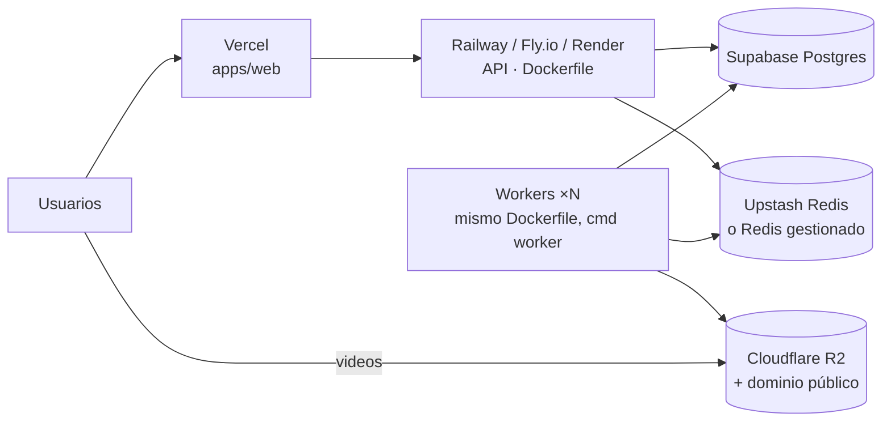

# 4. Instrucciones de despliegue

## 4.1 Desarrollo local (sin claves, todo en mock)

Requisitos: Node 20+, ffmpeg (con libass y libfreetype: el paquete de Ubuntu/Debian y el de Homebrew los incluyen), Docker (o Postgres 16 + Redis 7 instalados).

```bash
git clone <repo> frutinovela-ai && cd frutinovela-ai
npm install

# Infraestructura
docker compose up -d postgres redis

# API + worker
cp apps/api/.env.example apps/api/.env          # todo en mock por defecto
npm run db:migrate                               # crea las tablas
npm run dev:api                                  # http://localhost:4000
npm run dev:worker                               # en otra terminal

# Web
cp apps/web/.env.example apps/web/.env.local
npm run dev:web                                  # http://localhost:3000
```

Con `*_PROVIDER=mock` el flujo completo funciona: guion de ejemplo, personajes placeholder, capítulos con cartelas, voces sintéticas, música, subtítulos, versión vertical y exportaciones. Útil para desarrollar la UI y validar el montaje sin gastar.

Activa proveedores reales uno a uno en `apps/api/.env`:

```env
LLM_PROVIDER=claude        ANTHROPIC_API_KEY=sk-ant-...
IMAGE_PROVIDER=fal         FAL_KEY=...
TTS_PROVIDER=elevenlabs    ELEVENLABS_API_KEY=...
MUSIC_PROVIDER=elevenlabs  # o library + assets/music/<mood>/*.mp3
VIDEO_PROVIDER=runway      RUNWAY_API_KEY=...        # o kling + KLING_ACCESS_KEY/KLING_SECRET_KEY
LIPSYNC_PROVIDER=synclabs  SYNCLABS_API_KEY=...      # requiere STORAGE_DRIVER=s3 con URLs públicas
```

> En local (`STORAGE_DRIVER=local`) las imágenes se envían a fal/Runway/Kling como *data URI*. Para lip-sync, y en producción, usa R2/S3: los proveedores descargan los assets por URL.

## 4.2 Todo con Docker Compose

```bash
cp apps/api/.env.example .env      # pon tus claves; las URLs de BD/Redis/S3 las fija el compose
docker compose up --build
# web http://localhost:3000 · api http://localhost:4000 · consola MinIO http://localhost:9001 (fruti / frutifruti)
```

El compose levanta Postgres, Redis (con `noeviction`, requisito de BullMQ), MinIO como S3 con bucket público de lectura, la API (aplica migraciones al arrancar), un worker y la web. Escala workers con `docker compose up --scale worker=3`.

## 4.3 Producción recomendada



### Base de datos — Supabase

1. Crea el proyecto. En *Project Settings → Database* copia:
   - **Transaction pooler** (puerto 6543) → `DATABASE_URL` añadiendo `?pgbouncer=true&connection_limit=5`.
   - **Direct connection** (puerto 5432) → `DIRECT_URL` (la usan las migraciones).
2. Desde tu máquina o CI: `npm run db:deploy -w @fruti/api` (= `prisma migrate deploy`).
3. Opcional: Supabase Auth. Sustituye `owner()` en `apps/api/src/routes/index.ts` por la verificación del JWT (`Authorization: Bearer`) y usa el `sub` como `ownerId`; en el frontend envía el token en `lib/api.ts`.

### Redis

Upstash (`rediss://default:<pass>@<host>:6379`) o Redis de Railway/Render. Requisitos de BullMQ: `maxmemory-policy noeviction` y conexiones persistentes (no el endpoint REST de Upstash). La URL `rediss://` activa TLS automáticamente (`queues/index.ts`).

### Almacenamiento — Cloudflare R2

1. Crea el bucket `frutinovelas`.
2. *R2 → Manage API tokens*: token con permiso *Object Read & Write* sobre el bucket → `S3_ACCESS_KEY_ID` / `S3_SECRET_ACCESS_KEY`.
3. `S3_ENDPOINT=https://<ACCOUNT_ID>.r2.cloudflarestorage.com`, `S3_REGION=auto`.
4. Conecta un dominio propio al bucket (*Settings → Custom Domains*, p.ej. `media.tudominio.com`) → `S3_PUBLIC_BASE_URL=https://media.tudominio.com`. Sin dominio público la API firma URLs temporales (6 h), que también funcionan.
5. CORS del bucket (para el `<video>` y las descargas):

```json
[{ "AllowedOrigins": ["https://tu-app.vercel.app"], "AllowedMethods": ["GET", "HEAD"], "AllowedHeaders": ["*"], "MaxAgeSeconds": 3600 }]
```

AWS S3 funciona igual: deja `S3_ENDPOINT` vacío y pon la región real.

### API y workers — Railway / Fly.io / Render

Una única imagen (`apps/api/Dockerfile`, incluye ffmpeg y fuentes) con dos servicios:

| Servicio | Comando | Recursos orientativos |
|---|---|---|
| `api` | por defecto (`prisma migrate deploy && node dist/server.js`) | 0.5 vCPU · 512 MB |
| `worker` | `node dist/worker.js` | 2 vCPU · 2–4 GB RAM · 10 GB de disco temporal |

Variables comunes: todas las de `apps/api/.env.example` con `NODE_ENV=production`, `STORAGE_DRIVER=s3`, `PUBLIC_API_URL=https://api.tudominio.com` (origen; las rutas viven en `/api`), `WEB_ORIGIN=https://tu-app.vercel.app` (admite varias separadas por coma).

- **Railway**: *New → Deploy from repo*, *Dockerfile path* `apps/api/Dockerfile`, *root* el repo. Duplica el servicio para el worker y cambia *Start command*.
- **Fly.io**: `fly launch --dockerfile apps/api/Dockerfile`, y en `fly.toml` dos `[processes]`: `api = "sh -c 'npx prisma migrate deploy && node dist/server.js'"`, `worker = "node dist/worker.js"`; `fly scale count worker=2`.
- **Render**: un *Web Service* y un *Background Worker* desde el mismo Dockerfile.

El worker **no** puede ser serverless: un capítulo tarda de minutos a decenas de minutos (render de video de terceros + ffmpeg). Los jobs tienen `lockDuration` de 10 min con renovación automática; al reiniciar un worker, BullMQ reasigna el job y el capítulo se **reanuda** reutilizando los planos ya terminados.

Ajuste de throughput: `SHOT_CONCURRENCY` (planos simultáneos por capítulo) × `CHAPTER_CONCURRENCY` (capítulos de novelas distintas por réplica) × réplicas ≤ límite de concurrencia de tu cuenta en Runway/Kling.

### Web + API en un solo proyecto de Vercel (services)

`vercel.json` en la raíz define dos servicios del mismo proyecto y un único dominio:

| Servicio | Raíz | Público en | Notas |
|---|---|---|---|
| `web` | `apps/web` (Next.js) | `/(.*)` | Llama a la API por ruta relativa `/api/...` (deja `NEXT_PUBLIC_API_URL` vacío) |
| `api` | `apps/api` (Fastify, `src/server.ts`) | `/api/(.*)` | Todas sus rutas ya llevan el prefijo `/api` |

No hay *bindings*: ningún servicio llama a otro desde el servidor; el navegador habla con la API a través de la rewrite pública.

1. *New Project* → importa el repo con **Root Directory = raíz del repo** (donde está `vercel.json`).
2. Variables de entorno del proyecto: todas las de `apps/api/.env.example` con `STORAGE_DRIVER=s3`, `PUBLIC_API_URL=https://<tu-dominio>` y `WEB_ORIGIN=https://<tu-dominio>`. Prisma Client se genera en el `postinstall` de `apps/api`.
3. Pruébalo en local con `vercel dev` (levanta ambos servicios con el enrutado real).
   Tras desplegar, abre `https://<tu-dominio>/api/health`: devuelve `missing` (variables obligatorias que faltan: `DATABASE_URL`, `REDIS_URL` y, con `STORAGE_DRIVER=s3`, las credenciales S3) y `warnings`. Mientras falte alguna, toda la API responde **503 con el nombre de la variable** en vez de un 500 genérico.

   | Variable obligatoria en Vercel | Ejemplo |
   |---|---|
   | `DATABASE_URL` | pooler de Supabase `…:6543/postgres?pgbouncer=true&connection_limit=5` |
   | `DIRECT_URL` | conexión directa `…:5432/postgres` (migraciones) |
   | `REDIS_URL` | `rediss://default:<pass>@<host>.upstash.io:6379` |
   | `STORAGE_DRIVER` + `S3_*` | `s3` + credenciales de R2 |

   Ejecuta las migraciones una vez desde tu máquina (`npm run db:deploy -w @fruti/api` con `DIRECT_URL`) antes de usar la app.
4. **El worker no corre en Vercel**: los capítulos tardan minutos y usan ffmpeg. Despliega `apps/api/Dockerfile` con `node dist/worker.js` en Railway / Fly.io / Render (sección anterior), apuntando a la misma Postgres, Redis y R2. La función `api` de Vercel solo encola jobs y lee la BD.

Alternativas: solo la web en Vercel (Root Directory `apps/web`, `NEXT_PUBLIC_API_URL=https://api.tudominio.com`) con la API en el contenedor, o `apps/web/Dockerfile` (`output: "standalone"`) en cualquier host.

## 4.4 Checklist de puesta en producción

- [ ] `LLM_PROVIDER=claude` y una novela de prueba de 8 capítulos genera biblia + guiones sin errores.
- [ ] Imágenes: hoja de referencia aprobada para 2–3 personajes de prueba (mira bien manos y paleta).
- [ ] Un solo capítulo real con `VIDEO_PROVIDER=runway|kling` antes de habilitar “Generar todos”.
- [ ] R2: los `<video>` cargan desde el dominio público y la descarga del ZIP funciona (CORS).
- [ ] Redis con `noeviction` y persistencia (AOF) para no perder colas en reinicios.
- [ ] Alertas: `FAILED` en `Novela.status`/`Chapter.status` (consulta SQL periódica o un webhook en `worker.on("failed")`).
- [ ] Límites por usuario (novelas/día) antes de abrir al público: el coste lo domina el video.
- [ ] Revisar términos de uso comercial de cada proveedor (voces, música, video) para publicar en redes.
- [ ] Backups de Postgres activados (Supabase los incluye en planes de pago) y ciclo de vida en R2 para borrar `novelas/*/chapters/*/shots/` intermedios tras 30 días si quieres ahorrar espacio.

## 4.5 Comandos útiles

```bash
npm run typecheck                    # shared + api + web
npm run build                        # build de producción de todo
npm run db:migrate                   # nueva migración en desarrollo
npm run db:deploy -w @fruti/api      # aplicar migraciones en producción
docker compose up --scale worker=3   # más workers en local
```
